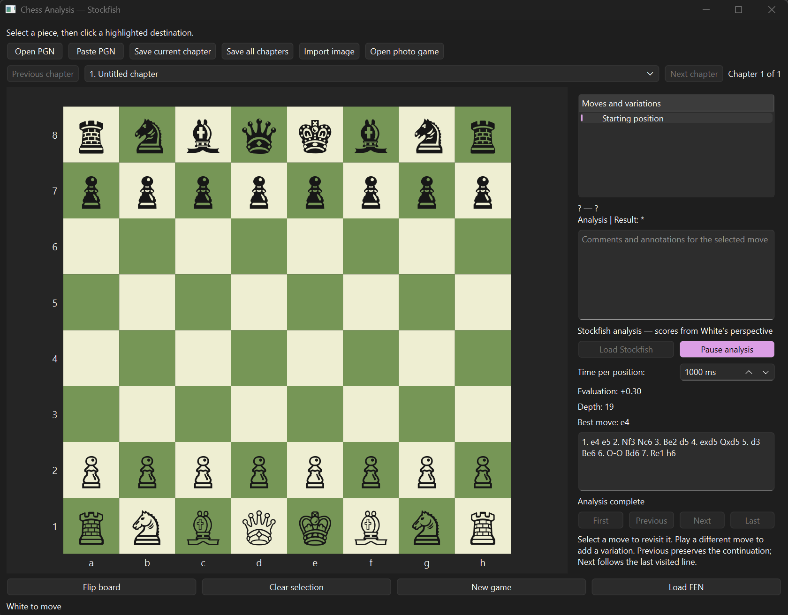
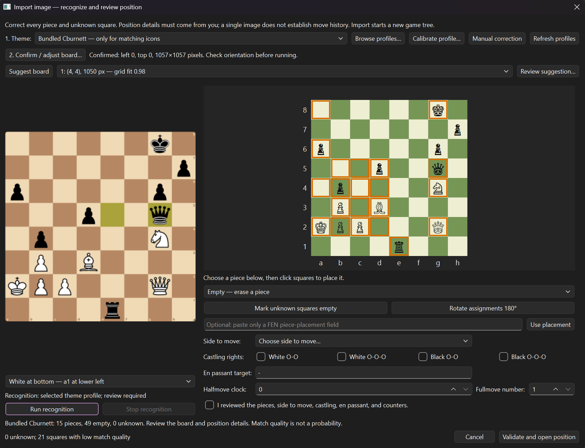

# Chess Analysis App — GUI Guide

This document explains the interface, its behaviour, and the features implemented in the supplied `ChessProject-main-test(1).zip`. It was checked against the project source and the two supplied screenshots on 27 November 2026.

## 1. Purpose and main concepts

The application is a desktop chess analysis workspace. You can enter legal moves, explore alternative continuations, review PGN games, switch between PGN chapters, load positions, and request Stockfish analysis. It also provides workflows for importing a position from one image and reconstructing a game from photographs taken after successive moves.

Three concepts explain how navigation works:

| Concept | Meaning |
| --- | --- |
| Study | The currently loaded document, containing one or more chapters. |
| Chapter | One PGN game, with its own starting position, moves, variations, and annotations. |
| Selected position | The starting position or move currently selected within a chapter. The board and engine analysis follow this selection. |

Stockfish provides advice. Users enter moves for both sides; the GUI does not automatically play Stockfish's suggested reply.

## 2. Main window layout

The first screenshot shows the main window, titled **Chess Analysis — Stockfish**. The large board occupies the left side, with game navigation and analysis on the right. File controls and chapter navigation sit above them; general board controls and status messages sit below.

The window can be resized. Drag the divider between the board and sidebar to adjust their relative widths. The board scales to the available space. Colours around window controls can vary with the operating system; the board itself uses green and cream squares.

### 2.1 File and import controls

| Control | Behaviour |
| --- | --- |
| **Open PGN** | Opens a PGN file. Every game in a multi-game file becomes a chapter. |
| **Paste PGN** | Opens a text dialog for pasting one or more PGN games. Confirm with **OK** to import them. |
| **Save current chapter** | Exports the active chapter, including all its variations and retained annotations, as one PGN game. |
| **Save all chapters** | Exports the complete study as a multi-game PGN, preserving chapter order. |
| **Import image** | Opens one image in the position recognition and correction dialog. |
| **Open photo game** | Selects a folder of real-board photographs and starts reconstructing the moves. |

PGN imports support variations, comments, numerical annotation glyphs, headers, and custom starting positions. Files are read as UTF-8; if decoding fails, the GUI offers a Latin-1 retry. Invalid input produces an error message.

Opening new content replaces the current study rather than adding chapters to it. When the current document contains moves or multiple chapters, the application asks before replacement. Save any work you want to retain first.

### 2.2 Chapter navigation

The row below the file controls contains **Previous chapter**, a chapter selector, **Next chapter**, and a counter such as **Chapter 2 of 5**.

- Select any chapter directly from the dropdown, or move through chapters in file order.
- Each chapter retains its selected move and variations during the session. Returning to it restores the position you left selected.
- The chapter buttons become unavailable at the beginning and end of the document; navigation does not wrap around.
- With a single chapter, both chapter buttons are unavailable.

Chapter names come from the PGN's `ChapterName` header, then `Event`, then player names, with **Untitled chapter** as the fallback. The selector adds a chapter number. Chapter navigation is separate from move navigation.

Chapters are validated when first opened; a chapter containing an illegal move can therefore fail when selected. Saving all chapters also validates chapters that have not yet been opened, and reports a failure rather than silently omitting them.

### 2.3 Interactive chessboard

The board shows file letters and rank numbers. Initially White is at the bottom.

To make a move, click a piece belonging to the side to move, then click a highlighted destination. The selected square turns yellow. A dot marks a legal empty destination; a ring marks a legal capture destination. The last move's origin and destination receive a separate highlight.

Clicking another friendly piece changes the selection. Clicking the selected piece again clears it. Clicking an unrelated square clears the selection without making a move. This interface uses successive clicks rather than a drag-and-drop gesture.

The rules backend supplies legal moves and validates accepted moves, including castling, en passant, and promotion. Castling uses the king's legal destination. Promotion opens a dialog offering **Queen**, **Rook**, **Bishop**, or **Knight**; **Cancel** leaves the position unchanged.

### 2.4 Moves, variations, and annotations

The **Moves and variations** panel contains a selectable **Starting position** row and the chapter's recorded moves. Moves use standard algebraic notation where available. Alternative moves are indented and marked **(variation)**; their branches can be expanded or collapsed.

Selecting a row restores that position on the board. Playing a different legal move from an earlier position adds a variation while preserving the existing continuation. Playing an already recorded move returns to its existing branch.

Below the move tree, the GUI displays player names, event, and the PGN result field. A result of `*` means the recorded result is unfinished or unspecified. This metadata is distinct from the live position status at the bottom of the window.

The comments box displays comments associated with the selected move, including imported starting comments. Numerical annotations may appear beside moves as codes such as `$1`. The comments box is read-only: this version displays imported annotations but provides no GUI editor for writing them.

### 2.5 Move navigation buttons

| Button | Effect within the active chapter |
| --- | --- |
| **First** | Returns to the chapter's starting position, which may be a custom FEN. |
| **Previous** | Moves back one ply: one move by one player. It preserves the continuation. |
| **Next** | Follows the last visited continuation, or the original continuation if no preference exists. |
| **Last** | Follows that continuation to its final recorded position. |

These controls do not switch chapters. At a branch, selecting a variation records that route for later **Next** and **Last** navigation without changing which line is the original main line.

For example, open a chapter containing `1. e4 e5`, return to the position after `1. e4`, and play `1... c5`. Both Black replies remain available. Select either reply in the tree to explore it.

### 2.6 Stockfish analysis

| Control or display | Meaning |
| --- | --- |
| **Load Stockfish** | Selects a local Stockfish executable if one was not supplied at launch. |
| **Pause analysis / Resume analysis** | Disables or enables automatic analysis of the selected position. |
| **Time per position** | Search budget from **100 to 10,000 ms**, normally **1,000 ms**. |
| **Evaluation** | Score in pawn units, always from White's perspective. Positive favours White; negative favours Black. |
| **Depth** | Search depth reported by the engine. |
| **Best move** | The engine's suggested move in the selected position. |
| Suggested continuation box | The principal variation: the engine's preferred sequence of moves. |
| Engine status | Messages such as **Analyzing…**, **Analysis complete**, or an engine error. |

For example, `+0.30` indicates a small estimated advantage for White. Forced-mate scores appear as text such as **White mates in 3**. Search results are estimates and can change with the time allowed.

With analysis enabled, changing the move, chapter, or search time schedules analysis for the current position. Old results are cleared while the position changes, so a previous position's recommendation is not presented as current. Finished games receive a status message instead of a fresh search.

The suggested line is read-only. To explore it, enter its moves on the board. Without Stockfish, the core board, PGN, and navigation features remain usable. After an engine has been started, restart the application to choose another executable or recover from an engine failure.

### 2.7 Bottom controls and status

| Control | Effect |
| --- | --- |
| **Flip board** | Rotates the board display by 180 degrees, including coordinates. It does not change the position. |
| **Clear selection** | Removes the selected piece and legal-target markers. It does not remove pieces. |
| **New game** | Replaces the current study with one chapter at the standard starting position. |
| **Load FEN** | Accepts a complete six-field FEN and starts a new chapter at that position. |

The bottom status identifies the side to move, the current operation, or the game outcome. Supported outcome messages include checkmate, stalemate, insufficient material, the fifty-move rule, and threefold repetition. Errors appear separately in red.

Some controls are temporarily disabled during loading, replay, validation, or promotion. Navigation buttons are also disabled when there is no previous or next position.

## 3. Import image dialog

The second screenshot shows **Import image — recognize and review position**. The source image appears on the left; an editable interpretation appears on the right. This workflow imports one position, not the moves that led to it.

### 3.1 Select the recognition theme and board

The **Theme** dropdown chooses the piece-artwork profile. **Bundled Cburnett** is appropriate only when the image uses matching icons.

| Control | Purpose |
| --- | --- |
| **Browse profiles…** | Loads a reviewed theme profile from its `profile.json`. |
| **Calibrate profile…** | Creates and reviews a profile using a separate, clean screenshot of the standard starting position. |
| **Manual correction** | Allows the position to be entered or corrected manually. |
| **Refresh profiles** | Discovers additional reviewed profiles saved while the app is open. |
| **Confirm / adjust board…** | Opens a selector to confirm the playing-board rectangle and its grid. |
| **Suggest board** | Searches for possible board rectangles in the image. |
| **Review suggestion…** | Opens the selected proposal for adjustment and confirmation. |

A suggested rectangle is not confirmed until accepted in the selector. Its **grid fit** is a heuristic score, not a probability. Check that the grid matches all eight files and ranks.

Choose the source orientation beneath the image: **White at bottom — a1 at lower left** or **Black at bottom — h8 at lower left**. Then select **Run recognition**. **Stop recognition** cancels the current background operation.

### 3.2 Review and correct the draft

The right-hand board is a draft that must be checked against the original image. A `?` indicates an unresolved square. Orange borders indicate low match quality, not a calibrated probability of error. Even a draft with zero unknown squares can contain incorrect pieces, as the supplied screenshot illustrates.

- Choose a piece and colour from the palette, then click draft squares to place it.
- Choose **Empty — erase a piece** to clear a square, or **Unknown — needs review** to flag it.
- **Mark unknown squares empty** clears unresolved squares only; use it after checking them.
- **Rotate assignments 180°** remaps the existing assignments. It does not rerun recognition.
- The optional placement field accepts only the first, piece-placement field of a FEN. Select **Use placement** to apply it. Use the main window's **Load FEN** for a complete FEN.

Changing the profile, crop, or orientation removes review confirmation. If recognition inputs have changed, rerun recognition or explicitly use manual correction and review the resulting board.

### 3.3 Supply position details

A single image cannot establish whose turn it is or the move history. Supply these fields yourself:

| Field | Meaning |
| --- | --- |
| **Side to move** | White or Black. |
| **Castling rights** | The four White/Black kingside and queenside rights. Select only rights supported by the game history. |
| **En passant target** | The target square after the relevant double pawn push, or `-` for none. |
| **Halfmove clock** | Number of plies since the last pawn move or capture; the default is 0. |
| **Fullmove number** | Move number, starting at 1 and increasing after Black's move. |

After resolving every unknown square and reviewing all details, tick **I reviewed the pieces, side to move, castling, en passant, and counters.** Select **Validate and open position**.

The rules backend validates the complete position. On success, it becomes the starting position of a new single-chapter study, replacing the previous document after any applicable confirmation. Enabled Stockfish analysis follows it. On rejection, the draft stays available for correction. **Cancel** closes the dialog without importing the draft.

Recognition is designed for supported 2D board artwork and matching profiles. Overlays, different icons, image damage, or inaccurate cropping can cause mistakes. A valid chess position is not proof that the recognition matched the image.

## 4. Open photo game

**Open photo game** reconstructs a sequence of moves from a folder, using a separate computer-vision pipeline. The GUI assumes the standard starting position and automatically estimates orientation for each photograph.

Prepare one photograph after every player's move. An initial photograph of the starting setup is allowed. Keep all four board corners visible and name files in chronological order, for example `001.jpg`, `002.jpg`, and `003.jpg`: the reader sorts by filename.

Select the folder and watch progress in the main status area. A successful reconstruction loads through the PGN import workflow and can then be navigated, analysed, extended with variations, and saved. Review the reconstructed moves before relying on them.

This feature requires the vision dependencies, model weights, and its engine setup. JPG, JPEG, PNG, and BMP are supported input choices; HEIC/HEIF conversion currently relies on macOS's `sips` utility. The GUI runs the reader unattended and does not expose the command-line reader's interactive correction prompts or custom starting-FEN option.

## 5. Saving and current boundaries

Use **Save current chapter** for one game and **Save all chapters** for the whole document. Export includes recorded moves and variations, not the Stockfish analysis panel. Choosing a move in the GUI does not turn its engine suggestion into a saved variation.

Changes and chapter navigation state remain in memory during the session. There is no automatic save or close-time unsaved-changes prompt in this version. Save explicitly before exiting or replacing the study. Reopening a PGN restores its chess content; it does not restore the previous session's selected move.

The current GUI has no controls for creating, renaming, reordering, or deleting individual chapters, editing comments or game headers, or deleting variations. Its chapter controls browse the games supplied by a PGN.

## 6. How the interface works internally

The desktop interface uses **PySide6**. A Python controller connects board clicks and navigation to the project's **C rules backend**, which validates positions, supplies legal moves, and restores move history when navigating. Python game trees retain each chapter's positions and alternative lines.

**Stockfish** runs separately through UCI, the chess-engine communication protocol. Image recognition and photo reconstruction also run through background workers/processes so their heavier work does not block the main interface.

The principal source references for this guide are `chess_app/main_window.py`, `controller.py`, `board_widget.py`, `game_tree.py`, `study.py`, `pgn_service.py`, `analysis_controller.py`, `image_import_dialog.py`, `image_recognition_setup.py`, `photo_importer.py`, `2d_recognition/lichess_2d/workflow_dialog.py`, and `vision/scripts/run_game.py`. Behaviour descriptions were checked against the supplied source; this guide does not claim a live GUI or recognition accuracy test.
