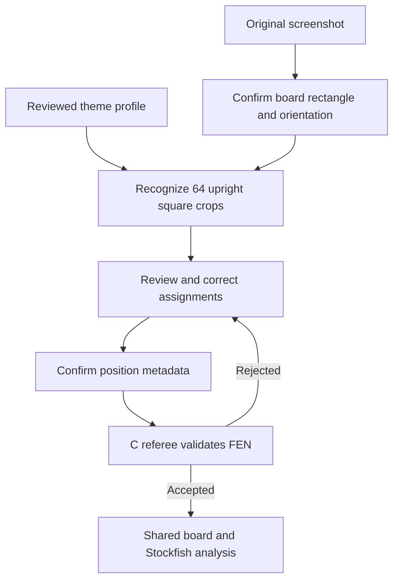

# 2D Chess Board Recognition

Convert a screenshot of a digital chessboard into an editable position in the
project's chess analysis application. The workflow combines a confirmed board
rectangle, an explicitly selected piece-theme profile, conservative template
matching, manual review, and validation by the team's C referee.

This README documents the **existing pre-migration `2d_recognition/` layout**.
Command-line scripts remain at this folder's root. It does not require moving
files into `tools/`, `datasets/`, or a different test hierarchy.

## Contents

1. [Purpose and scope](#1-purpose-and-scope)
2. [Supported inputs and limitations](#2-supported-inputs-and-limitations)
3. [Installation and quick start](#3-installation-and-quick-start)
4. [GUI workflow](#4-gui-workflow)
5. [How recognition works](#5-how-recognition-works)
6. [Board rectangles and orientation](#6-board-rectangles-and-orientation)
7. [Theme profiles and calibration](#7-theme-profiles-and-calibration)
8. [Command-line recognition and extraction](#8-command-line-recognition-and-extraction)
9. [Python API and worker integration](#9-python-api-and-worker-integration)
10. [Files and responsibilities](#10-files-and-responsibilities)
11. [Recording evaluation datasets](#11-recording-evaluation-datasets)
12. [Evaluation metrics and acceptance](#12-evaluation-metrics-and-acceptance)
13. [JPEG, scaling, and board-location checks](#13-jpeg-scaling-and-board-location-checks)
14. [Automated position collection](#14-automated-position-collection)
15. [Historical results](#15-historical-results)
16. [Testing](#16-testing)
17. [Troubleshooting](#17-troubleshooting)
18. [Maintenance and Git](#18-maintenance-and-git)
19. [Extension points](#19-extension-points)
20. [Artwork and attribution](#20-artwork-and-attribution)

## 1. Purpose and scope

The recognizer estimates **which piece, if any, occupies each square**. Its
output feeds the same review editor, legal-position validation, game tree, and
Stockfish analysis used elsewhere in the application.

The core is a template-based recognizer. Calibration extracts examples and
foreground masks from a known starting position; it does not train a neural
network. The supplied artwork is Cburnett. Additional digital piece themes
need matching reviewed profiles and their own evaluation images.

The stages below have separate responsibilities:

| Component | Responsibility |
| --- | --- |
| Board locator and crop selector | Identify the intended 8×8 playing area. |
| Theme profile | Describe the actual piece artwork and preprocessing settings. |
| Recognizer | Return piece, known-empty, or unknown assignments. |
| Review editor | Let the user correct assignments and supply position details. |
| C referee | Validate the confirmed FEN and manage legal chess state. |
| Stockfish integration | Analyze the accepted position. |



A single screenshot does not reliably establish whose turn it is, castling
rights, the last double pawn push, move counters, or repetition history. These
are separate inputs. Importing an image starts a new game tree; it does not
reconstruct the moves that produced the position or create a complete game PGN.

## 2. Supported inputs and limitations

The intended input is a flat digital board with upright icons, readable square
contents, and a matching theme profile. PNG screenshots are the preferred
starting point. JPEG can be decoded and tested, but compression can introduce
unknowns or mistakes. Other formats depend on Pillow's available decoders.

| Property | Current behavior |
| --- | --- |
| Image loading | Applies EXIF orientation and converts to RGB. |
| File size | Up to 50 MiB under the loader's size check. |
| Decoded image | At most 60,000,000 pixels. |
| Confirmed board | At least 128 pixels wide and high, inside the source image. |
| Shape | Approximately square; only small edge-rounding differences are accepted. |
| Normalization | 512×512 board, divided into 64 crops of 64×64 pixels. |
| Orientation | White-bottom and Black-bottom mappings; icons are not rotated. |
| Unknown input | Unresolved assignments remain `?`. |
| Physical/perspective board photographs | Outside the intended 2D pipeline. |

The recognizer has limited tolerance for small shifts, icon-size changes,
resampling, and uniform square highlights. It is not a universal recognizer for
all websites, piece sets, board textures, animations, screenshots, or overlays.

Arrows, move dots, selection outlines, severe JPEG artifacts, and occlusion can
hide piece evidence. Colored overlay checks are conservative but incomplete:
grayscale arrows, faint strokes, and colors resembling the artwork/background
can escape detection. User review remains required even when there are no `?`
cells. Referee acceptance establishes a valid position under its rules, not that
the position matches the screenshot.

## 3. Installation and quick start

### Working directory and Python environment

All PowerShell commands in this README assume the repository root, containing
both `chess_app/` and `2d_recognition/`. Use the same Windows Python environment
that already runs the GUI. The project's established local setup uses Python
3.12, with the C referee and Stockfish running through WSL Ubuntu.

```powershell
cd "C:\path\to\ChessProject"
python --version
python -m pip install -r .\2d_recognition\requirements-lichess2d.txt
```

Replace the example project path with your actual path. Core requirements in
the supplied requirements file are:

| Dependency | Use |
| --- | --- |
| `numpy>=1.26,<3` | Pixel arrays, background estimation, masks, template comparisons. |
| `Pillow>=10.3,<13` | Image decoding, EXIF correction, resizing, crops, diagnostics. |
| PySide6, supplied by the GUI environment | Interactive crop/profile dialogs and QProcess clients. |
| C referee release executable | Validate the confirmed image-derived position. |
| Stockfish | Optional downstream analysis. |
| Playwright and Chromium | Optional live browser screenshot collection only. |

Install GUI requirements if setting up a fresh environment:

```powershell
python -m pip install -r .\chess_app\requirements.txt
```

The standalone core can recognize and evaluate cropped images without starting
Qt, the C referee, or Stockfish. Interactive `--select`/`--review` modes need Qt.

### Start the application

```powershell
python chess_app/main.py --stockfish-wsl --stockfish "/usr/games/stockfish"
```

This Stockfish path assumes it is installed there in Ubuntu. On the established
Windows setup, `main.py` selects the repository's WSL referee build and Ubuntu
by default. To open the GUI without starting Stockfish:

```powershell
python chess_app/main.py
```

The normal separate-folder installation discovers `2d_recognition/lichess_2d`
automatically. Select the profile inside the GUI; no long image-recognizer
launch command is needed. The discovery helper also supports the earlier
`2d_recognition/chess_app/lichess_2d` location, but this README's CLI paths assume
the direct layout. Keep one intended recognition installation discoverable.

The referee must already be built. For the established Windows/Ubuntu setup,
build it from the repository using its WSL path, for example:

```powershell
wsl --distribution Ubuntu --cd "/mnt/c/path/to/ChessProject" --exec make release CC=gcc
```

Use the actual `/mnt/c/...` path. Explicit `--distribution Ubuntu` avoids
accidentally launching a different default WSL distribution such as Docker's.

## 4. GUI workflow

1. **Import image.** Open the original screenshot rather than a screenshot of
   an already resized preview.
2. **Choose the matching theme.** Select a reviewed profile, browse to its
   `profile.json`, or explicitly choose the bundled Cburnett artwork if it
   matches the screenshot. Missing or invalid profiles do not silently select
   a different model.
3. **Find the board.** Click **Suggest board** for automatic proposals, or use
   **Confirm / adjust board…** to select manually.
4. **Review a proposal.** Select a suggestion and click **Review suggestion…**.
   Align every grid line with the playing board and confirm. A suggestion does
   not become the confirmed rectangle until accepted in the selector.
5. **Choose orientation.** Set White at bottom or Black at bottom. Orientation
   can be set before selecting the crop to show the corresponding grid labels.
6. **Run recognition.** The selected profile, original-image rectangle, and
   orientation travel to the background worker.
7. **Correct the draft.** Resolve all `?` squares and inspect low-quality
   predictions. Use the piece palette or paste a known FEN placement field.
8. **Supply metadata.** Confirm side to move, castling rights, en passant target,
   halfmove clock, and fullmove number. Confirm the review checkbox.
9. **Validate and open position.** The C referee checks the complete FEN. Success
   opens a new tree on the shared board; enabled Stockfish analysis follows the
   selected position. Rejection leaves the draft available for correction.

Orange borders indicate low template match quality; `?` means unresolved. The
legacy GUI field is called `confidence`, but its values are not calibrated
probabilities. A high score is not proof that a piece is correct.

**Mark unknown squares empty** is an explicit manual action, not recognition
evidence. Use it only after checking that those squares really are empty.
**Rotate assignments 180°** remaps existing assignments; it does not rerun the
recognizer or rotate the artwork in the source image.

For an unsupported theme, use **Calibrate profile…** with a separate clean
starting-position reference, or choose **Manual correction**. Profile selection
is remembered in `settings/image_import.json`. A missing saved profile leaves
recognition unconfigured and displays feedback. **Refresh profiles** discovers
additional reviewed profiles saved while the application is open.

Changing profile, rectangle, or orientation removes review confirmation and
invalidates old-input recognition. A recognized draft with changed inputs must
be recognized again or explicitly handled as a manually reviewed correction.
Cancelling a crop selection preserves the previous confirmed rectangle.

## 5. How recognition works

### 5.1 Load, crop, and normalize

`board_locator_2d.py` decodes the image, corrects EXIF orientation, checks the
rectangle, crops the board, and resizes it once to 512×512. It returns exactly
64 named square crops. Square names use canonical chess coordinates.

### 5.2 Estimate the local background and foreground

For each square, the recognizer estimates a background color using the outer
rim. Comparisons ignore a narrow rim and corner areas where coordinate labels
may appear. It measures deviation from the background and the fraction of
pixels that exhibit foreground contrast.

An empty square requires positive evidence of a sufficiently uniform
background. A failed piece comparison cannot turn into an empty assignment.
Coordinate labels or compression artifacts can still make otherwise empty
squares uncertain, especially after substantial scaling.

### 5.3 Compare distinct piece types

For occupied-looking crops, compare templates for all 12 piece labels. The
bundled path composites transparent templates against the observed background.
Calibrated profiles use conservative foreground cores plus an outside-support
background term, excluding uncertain antialiased boundaries.

Default template variants use sizes 62, 64, and 66 pixels and shifts of -1, 0,
and +1 pixels on both axes. These absorb small scale/alignment differences;
they do not cover arbitrary icon geometry or a substantially incorrect crop.

Find the best score for each **distinct piece label**, then compare the best
label with the runner-up. A poor best match or insufficient separation returns
`?`. Match quality is derived from template error and separation, not a trained
estimate of the probability of correctness.

### 5.4 Check colored overlay evidence

`overlay_guard.py` derives a foreground palette from the selected artwork or
profile. It allows antialiased blends with the current square background, so
a uniform highlight need not look like an arrow. Connected colored strokes
inconsistent with both can force an otherwise accepted result to unknown.
Overlay evidence is recorded even if a square was already unknown for another
reason. The guard cannot reconstruct the piece hidden underneath an arrow.

### 5.5 Return an inspectable result

The native result includes assignments, match quality, per-square reasons and
errors, overlay evidence, counts, engine/profile fingerprints, and the hash of
the normalized board. A placement string is produced only when all squares
are resolved. Recognition does not assign FEN metadata or validate chess rules.

Current `RecognitionSettings` defaults are:

| Setting | Default | Purpose |
| --- | ---: | --- |
| `empty_max_rmse` | `0.018` | Maximum background error for an empty decision. |
| `foreground_contrast` | `0.10` | Contrast used to measure foreground content. |
| `max_empty_foreground_fraction` | `0.001` | Maximum foreground fraction for empty. |
| `max_template_error` | `0.105` | Reject a poorly fitting best template. |
| `min_piece_margin` | `0.018` | Reject insufficient separation between piece labels. |

Profile preprocessing supplies the match-error and margin values when a
reviewed profile is loaded. Inspect the source and saved report identity for
the values actually used in a particular run. Tune only on a validation set,
then evaluate again on separate held-out captures.

## 6. Board rectangles and orientation

Rectangles have the form **`[left, top, width, height]`**, not two opposite
corners. Coordinates refer to the decoded original image **after EXIF
correction**, not the scaled GUI preview or the normalized 512×512 board.
Right and bottom bounds are exclusive.

For example, `[117, 83, 512, 512]` covers x coordinates 117 through 628 and y
coordinates 83 through 594. Exclude clocks, player panels, outer board frames,
and labels outside the playing area. A slightly misplaced grid contaminates
many square crops even when the rectangle appears visually close.

| Image orientation | Visual top-left square | Visual bottom-right square |
| --- | --- | --- |
| White at bottom | `a8` | `h1` |
| Black at bottom | `h1` | `a8` |

**Flipping changes the coordinate mapping, not the crop pixels.** Website
piece icons normally stay upright in both views. Rotating each icon would
make its appearance differ from the profile.

Automatic board proposals look for repeated alternating color runs, combine
horizontal/vertical candidates, and check an 8×8 background pattern. Search
uses a preview capped at 960 pixels on its longest side and returns up to three
proposals by default. Its heuristic grid-fit score is not a probability.

The run-based detector needs enough visible checkerboard structure. A board
that becomes very small in a full-screen preview, low-contrast/texture-heavy
themes, strong overlays, or cropped edges can prevent proposals. Manual grid
selection remains available and is the correct fallback.

## 7. Theme profiles and calibration

### Prepare a reference

Use a separate screenshot showing the **standard initial chess position**
with the same piece theme as the target images. It supplies all 12 piece labels
and empty squares on both background colors. Choose the correct orientation.
Remove arrows, highlights, hover effects, and piece animations. Keep the
calibration screenshot out of the final evaluation set.

### Calibrate through the GUI

Choose **Calibrate profile…**, select the clean reference, confirm orientation
and grid, and give the profile a name. Inspect the review sheet and masks
before accepting it. Cancelled/unreviewed profiles remain drafts and cannot be
used as working recognition profiles.

### Calibrate through the CLI

Choose a new destination; existing profile directories are not overwritten:

```powershell
python 2d_recognition/calibrate_2d.py --image "C:\images\clean-start.png" --name "My second theme" --white-bottom --select --review --output "2d_recognition/profiles/my_second_theme"
```

For a known rectangle and no interactive selection/review window:

```powershell
python 2d_recognition/calibrate_2d.py --image "C:\images\clean-start.png" --name "My second theme" --white-bottom --rect 117 83 512 512 --output "2d_recognition/profiles/my_second_theme"
```

The latter saves a draft. Open `template_review.png` and inspect it before
separately approving:

```powershell
python 2d_recognition/calibrate_2d.py --approve "2d_recognition/profiles/my_second_theme"
```

Check that each label has the right color/type, the support mask covers its
icon, the core excludes background pixels, and the composited previews remain
plausible on both square backgrounds. The displayed RGBA edges are estimates;
matching relies on the foreground core and outside-support pixels.

### Profile contents and integrity

| Profile item | Purpose |
| --- | --- |
| `profile.json` | Name, review state, preprocessing, source geometry, piece records, artifact hashes. |
| `reference_board.png` | Normalized calibration board. |
| `template_review.png` | Human review sheet. |
| `templates/` | Raw samples, support/core masks, and approximate RGBA templates. |
| `backgrounds/` | Sampled and modeled light/dark backgrounds. |
| `samples/` | Calibration-square samples retained for inspection. |

Keep the complete profile folder. The loader checks its schema, review state,
artifact paths, SHA-256 hashes, image sizes, and mask consistency. The supplied
`my_lichess` profile tracks 86 image artifacts; deleting samples or review
images that appear in its manifest also makes validation fail. Do not edit
templates or masks in place and then claim the original reviewed profile.
Create and review a new profile when changing calibration inputs/settings.

The remembered selection is local configuration. For example:

```json
{
  "version": 1,
  "profile": "builtin:cburnett"
}
```

Profile-file selections are stored relative to the settings directory when
possible. A saved profile path is therefore not necessarily relative to the
repository root. The GUI restores the explicit choice; it does not automatically
prefer `my_lichess` simply because that folder exists.

## 8. Command-line recognition and extraction

### Recognize an image using a reviewed profile

```powershell
python 2d_recognition/recognizer_2d.py --image "C:\images\position.png" --profile "2d_recognition/profiles/my_lichess/profile.json" --white-bottom --select --output "2d_recognition/evaluation/local/prediction.json" --diagnostics "2d_recognition/evaluation/local/position-debug"
```

For Black at bottom, replace `--white-bottom` with `--black-bottom`. They are
mutually exclusive. `--select` and `--rect` are mutually exclusive too.

For an image containing exactly the playing board, omit both crop options.
For a known crop, use `--rect LEFT TOP WIDTH HEIGHT`. To explicitly run the
bundled Cburnett CLI path, omit `--profile`:

```powershell
python 2d_recognition/recognizer_2d.py --image "C:\images\board-only.png" --white-bottom
```

The ordinary recognition/evaluation CLI `--profile` arguments expect a real
profile directory/file, not the GUI token `builtin:cburnett`. Omission selects
bundled artwork there. The stress-test script separately supports that token.

### Inspect board extraction without classification

```powershell
python 2d_recognition/check_board_extraction_2d.py --image "C:\images\position.png" --white-bottom --select --output "2d_recognition/evaluation/local/extraction"
```

This saves `source_grid.png`, `board.png`, `contact_sheet.png`, `extraction.json`,
and 64 named PNGs under `squares/`. Check the grid before diagnosing the model.

### Inspect recognition diagnostics

The current recognizer's `--diagnostics` directory contains:

| File | Interpretation |
| --- | --- |
| `board.png` | Actual normalized 512×512 input used for classification. |
| `square_sheet.png` | Square crops, assignments, best-match errors and margins. |
| `predictions.json` | Full per-square decisions, scores, reasons, and fingerprints. |

An output file with zero unknowns still requires visual review and metadata.
The CLI's successful exit reports successful processing; it is not an accuracy
certificate or an accepted chess position.

Run any supported script with `--help` to inspect its parser. Current tools are
`recognizer_2d.py`, `calibrate_2d.py`, `check_board_extraction_2d.py`,
`record_eval_case_2d.py`, `evaluate_2d.py`, `check_harder_inputs_2d.py`, and
`make_generated_demo_2d.py`, plus the scripts under `random50/`.

## 9. Python API and worker integration

### Native core API

From the repository root, expose the separate package directory explicitly
when using it outside the GUI:

```python
from pathlib import Path
import sys

sys.path.insert(0, str(Path("2d_recognition").resolve()))

from lichess_2d.board_locator_2d import BoardRect, load_image
from lichess_2d.recognizer_2d import Recognizer2D, save_diagnostics

model = Recognizer2D("2d_recognition/profiles/my_lichess/profile.json")
with load_image("position.png") as image:
    result, extraction = model.predict(
        image,
        white_bottom=True,
        rect=BoardRect(117, 83, 512, 512),
    )
    save_diagnostics(result, extraction, "2d_recognition/evaluation/local/api-debug")

assert len(result["pieces"]) == 64
print(result["placement"])  # None if any assignment is still unknown.
```

Reuse a `Recognizer2D` instance across a collection to avoid rebuilding its
template bank for each image. `Recognizer2D()` uses bundled Cburnett templates.
The native dictionary has `pieces`, `match_quality`, `details`, `placement`,
`engine`, `unknown_squares`, `known_empty_squares`, `overlay_squares`, and
`normalized_pixels_sha256`.

### Backend callable

The current GUI backend is `lichess_2d.adapter_2d:recognize`:

```python
def recognize(image_path, *, white_bottom, profile_path=None, board_rect=None):
    ...
```

`profile_path` must be a reviewed profile path or the explicitly selected token
`builtin:cburnett`. `None` means unconfigured in this adapter and raises useful
feedback. `board_rect` is an optional four-element list/tuple in source pixels.
Omit it only when the entire image is the intended square board.

The backend returns `pieces`, `confidence`, and `message`. It adapts the native
`match_quality` values into the existing `confidence` field. Square meanings are:

| Value | Meaning |
| --- | --- |
| `P N B R Q K` | White pawn, knight, bishop, rook, queen, king. |
| `p n b r q k` | Corresponding Black pieces. |
| Python `None` / JSON `null` | Positive evidence of an empty square. |
| `?` | Unresolved square; correction required. |

Successful 2D backend results contain all 64 canonical names. Never fill missing
or rejected predictions with empty squares. An illustrative complete-map shape
can be built without implying that unresolved squares are empty:

```python
example = {
    "pieces": {
        f"{file}{rank}": "?"
        for file in "abcdefgh"
        for rank in range(1, 9)
    },
    "confidence": {},
    "message": "Illustrative record only; review the board.",
}
example["pieces"].update(a1="R", a2=None)
```

### Worker protocol and lifecycle

`chess_app/image_recognition_client.py` starts a one-shot Python worker through
QProcess. Recognition runs in a child process, outside the GUI event loop.
The worker imports the configured callable and forwards validated options.
An example request is:

```json
{
  "path": "C:/images/position.png",
  "request_id": 42,
  "white_bottom": true,
  "backend": "lichess_2d.adapter_2d:recognize",
  "vision_path": "C:/path/to/ChessProject/2d_recognition",
  "profile_path": "C:/path/to/ChessProject/2d_recognition/profiles/my_lichess/profile.json",
  "board_rect": [117, 83, 512, 512]
}
```

The worker adds its own response envelope: `version: 1`, the request ID, and
`status: "ok"` on successful backend execution. Missing generic backend
configuration can return `status: "unavailable"`; backend/process failures use
the client's failure path. Backend logs go to stderr so stdout remains JSON.
The backend cannot override the worker's envelope fields.

Default recognition timeout is 60 seconds; proposal search uses 20 seconds.
The client bounds response output at 262,144 bytes, keeps a bounded stderr
tail, cancels/kills pending work, and emits closure once. The dialog checks
request IDs and an input fingerprint before applying results. That fingerprint
includes the selected profile/file stamp, rectangle, orientation, and source
file stamp. An old result must not replace a newer draft.

Board suggestions use a separate proposal worker/client, reusing the same
transport lifecycle with a proposal-specific response parser. They supply
rectangles and heuristic scores, not piece assignments or metadata.

## 10. Files and responsibilities

Paths in this section are relative to `2d_recognition/` unless stated otherwise.

### Runtime package

| File | Purpose |
| --- | --- |
| `lichess_2d/__init__.py` | Package description. |
| `board_locator_2d.py` | Load images, validate rectangles, normalize, split and name squares. |
| `board_locator.py` | Compatibility imports still used by current helpers/tests. |
| `board_proposals.py` | Automatic checkerboard proposals and validated proposal records. |
| `proposal_worker.py` | Run proposal search in a child Python process. |
| `proposal_client.py` | Proposal transport using the existing recognition client's lifecycle. |
| `crop_dialog.py` | Interactive source-image rectangle and 8×8 grid. |
| `theme_profiles.py` | Create, load, validate and approve profiles. |
| `profile_review.py` | Template/mask review dialog. |
| `calibration_workflow.py` | GUI reference selection, calibration and review. |
| `profile_preferences.py` | Persist the explicitly selected profile. |
| `recognizer.py` | Template banks and shared low-level matching helpers; also contains the earlier matching API. |
| `recognizer_2d.py` | Current conservative recognizer and detailed diagnostics. |
| `overlay_guard.py` | Profile-aware evidence of colored strokes. |
| `adapter_2d.py` | Current backend adapter to the shared worker response format. |
| `workflow_dialog.py` | Complete profile/crop/recognition/review workflow. |
| `notation.py` | Parse and construct FEN piece-placement fields. |
| `assets/` | Bundled artwork, SVG sources, attribution and license. |

### CLI and data

| Item | Purpose |
| --- | --- |
| Root `recognizer_2d.py` | Single-image CLI, distinct from the package implementation with the same filename. |
| `calibrate_2d.py` | Create/review/approve a profile. |
| `check_board_extraction_2d.py` | Inspect the grid and 64 crops without matching. |
| `record_eval_case_2d.py` | Record original screenshot/FEN cases and their file hashes. |
| `evaluate_2d.py` | Current dataset metrics, audits, reports and acceptance gate. |
| `check_harder_inputs_2d.py` | Derived JPEG/resampling tests and optional proposal checks. |
| `make_generated_demo_2d.py` | Create a labeled generated smoke-test dataset from the example images. |
| `requirements-lichess2d.txt` | Core dependency ranges. |
| `profiles/` | Complete theme-profile artifacts. |
| `settings/` | Local profile selection. |
| `evaluation/` | Recorded cases and evaluation outputs. |
| `examples_lichess2d/` | Generated example images and an older list-form manifest. |
| `random50/` | Position generator, collector, shared-format datasets, earlier reports and collector-specific artwork copy. |

Earlier files such as `check_lichess_2d.py`, `evaluate_lichess_2d.py`, and
`lichess_2d/adapter.py`, `dialog.py`, `integration.py` may remain for historical
tests/commands. The current workflow uses `adapter_2d.py` and `workflow_dialog.py`.
The older adapter uses an environment-variable profile path and has a different
signature; it is not an interchangeable replacement for the current adapter.
The historical `enable_lichess_2d.py` installer is not required by the current
automatic discovery setup. Leave retained compatibility files in place until
their actual importers have been updated and tested.

### GUI-side files

The sibling `chess_app/` owns `image_recognition_setup.py`,
`recognition_request.py`, `image_recognition_client.py`,
`image_recognition_worker.py`, `image_import.py`, and `image_import_dialog.py`.
The main controller/window own referee validation, tree replacement, and
subsequent analysis. This package does not implement chess move legality or
Stockfish's UCI engine protocol.

## 11. Recording evaluation datasets

Ground truth must come from the actual source position, such as its known FEN,
not from recognition predictions. Separate calibration images, tuning/validation
images, and held-out test images. Record orientation and the confirmed rectangle
for every image; labels must describe that exact capture.

Create a new manifest. The destination below must not already exist:

```powershell
python 2d_recognition/record_eval_case_2d.py --manifest "2d_recognition/evaluation/lichess-holdout-new/cases.json" --init --name "Lichess held-out screenshots" --origin real_screenshots --split test --profile "2d_recognition/profiles/my_lichess/profile.json"
```

Add a case using its original file and known FEN:

```powershell
python 2d_recognition/record_eval_case_2d.py --manifest "2d_recognition/evaluation/lichess-holdout-new/cases.json" --id endgame-01 --image "C:\images\endgame-01.png" --fen "6k1/1p3p2/7p/p3r3/P2R4/7P/2N2PP1/2R4K w - - 0 1" --white-bottom --select --phase endgame
```

The FEN shown is an example: use it only for an image of that exact position.
Repeat with unique case IDs and the correct position/orientation/phase. Replace
`--select` with `--rect` for a known rectangle. Omit crop options only for an
image consisting of exactly the playing board.

The recorder copies the **original file**, records its SHA-256 hash, and stores
the selected rectangle. Existing IDs and destination image files are not
overwritten. Do not leave `--image` or `--fen` blank; quote Windows paths with
spaces and use the full image filename, including its extension.

A version-1 manifest has this general shape; replace example paths/content
with the actual recorded data:

```json
{
  "version": 1,
  "dataset": {
    "name": "Lichess held-out screenshots",
    "origin": "real_screenshots",
    "split": "test",
    "profile": "../../profiles/my_lichess/profile.json"
  },
  "cases": [
    {
      "id": "endgame-01",
      "image": "images/endgame-01.png",
      "fen": "6k1/1p3p2/7p/p3r3/P2R4/7P/2N2PP1/2R4K w - - 0 1",
      "white_bottom": true,
      "rect": [0, 0, 512, 512],
      "tags": {"phase": "endgame"}
    }
  ]
}
```

Image paths and a manifest's stored profile path are relative to the manifest
directory, unless absolute. The recorder also writes `recorded_file_sha256`,
omitted from this schema example because it must match the actual image bytes.
Moving a manifest without its images or without rebasing its profile path can
break evaluation. A full FEN is accepted, but recognition metrics compare its
piece-placement field, not the metadata.

The earlier uploaded `evaluation/lichess-test/cases.json` contains one standard
starting-position case tagged `middlegame`. That tag should be `opening` if
still unchanged locally. One case is useful for a smoke test but does not
establish held-out accuracy, especially if related to the calibration capture.

## 12. Evaluation metrics and acceptance

Run the current evaluator on a recorded dataset:

```powershell
python 2d_recognition/evaluate_2d.py --manifest "2d_recognition/evaluation/lichess-holdout-new/cases.json" --output "2d_recognition/evaluation/local/holdout-report.json" --diagnostics "2d_recognition/evaluation/local/holdout-debug"
```

The profile can be stored in the manifest or overridden using `--profile` with
a reviewed profile path. Output includes JSON, CSV, and Markdown report files.
Per-case diagnostics show predictions alongside known placements.

| Metric | Definition and use |
| --- | --- |
| Completely correct boards / `board_accuracy` | Fraction of boards whose entire 64-square assignment matches ground truth. |
| `square_accuracy` | Correct assignments divided by all squares. |
| `occupied_square_accuracy` | Correct piece labels on occupied squares divided by occupied squares. |
| `empty_square_accuracy` | Correct empty decisions divided by truly empty squares. |
| `unknown_square_rate` | Unknown assignments divided by all squares. |
| `accuracy_among_accepted` | Correct non-unknown assignments divided by non-unknown assignments. |
| `coverage` | Fraction of all assignments that are not unknown. |
| `always_empty_baseline` | Fraction of truly empty squares: the square accuracy of always predicting empty. |

Unknown assignments count as incorrect. A processing failure counts as 64
unknown/incorrect squares and is not dropped. Separate counts distinguish
missed pieces, invented pieces, and wrong piece types. A high square accuracy
or accepted accuracy can coexist with many boards needing correction.

The proposed target is **at least 95% exact boards on a separate set of real,
clean screenshots from the supported theme**. The evaluator's default minimum
is 20 distinct image files. Always publish the actual count; the percentage
and default minimum alone do not establish broad statistical reliability.

To enforce the implemented gate:

```powershell
python 2d_recognition/evaluate_2d.py --manifest "2d_recognition/evaluation/lichess-holdout-new/cases.json" --output "2d_recognition/evaluation/local/holdout-report.json" --target 0.95 --min-images 20 --check-target
```

The gate checks declared real-screenshot origin, a declared held-out test split,
the number of distinct files, duplicate files/normalized boards, exact reuse of
the normalized calibration reference, processing failures, and board accuracy.
Origin and split are author-supplied metadata, not automatically verified.
Exact-hash audits cannot detect every near-duplicate or transformed calibration
capture; maintain genuine separation when creating datasets.

Coverage across orientations, board sizes, phases, and piece types on both
background colors is reported as **warnings**; these are not all hard gate
requirements in the current implementation. Inspect them alongside the score.

| Acceptance status | Meaning |
| --- | --- |
| `failed_processing` | One or more cases failed processing. |
| `insufficient_evidence` | Dataset provenance/split/count/duplicate/calibration checks are inadequate. |
| `target_not_met` | Evidence checks passed, but exact-board accuracy is below target. |
| `target_met_on_declared_dataset` | The implemented checks passed on the declared dataset. |

With `--check-target`, only the final status passes. Without it, an insufficient
or low-accuracy report can still be written successfully; inspect the report.
Processing failures return a nonzero exit status regardless of that flag.

## 13. JPEG, scaling, and board-location checks

Run derived stress cases from an existing manifest:

```powershell
$profilePath = (Resolve-Path ".\2d_recognition\profiles\my_lichess\profile.json").Path
python 2d_recognition/check_harder_inputs_2d.py --manifest "2d_recognition/evaluation/lichess-holdout-new/cases.json" --profile "$profilePath" --output "2d_recognition/evaluation/local/harder-inputs.json" --locate --fail-on-wrong
```

Use an absolute profile path here: this script resolves a relative profile path
against the manifest's directory. The example obtains the absolute path with
`Resolve-Path`, avoiding ambiguity with the repository working directory.

The script tests the original image, JPEG qualities 95/80/60, and resampling to
75%/125%/150%. It transforms the recorded rectangle with the image and preserves
source IDs, orientation, original-file counts, and the relationship between
derivatives. These are correlated cases, not extra independent screenshots.

`--locate` also compares board proposals with the recorded rectangle, including
a within-three-pixels measure. Recognition metrics still use the known
rectangle; location and classification measurements are kept separate.
`--fail-on-wrong` fails on accepted incorrect labels; `--require-exact` also
fails when any derived board needs correction. Processing errors fail the run.
An explicit `--profile builtin:cburnett` is supported by this stress script.

Digital resampling is an approximation, not a test of actual browser zoom or
Windows display scaling. Capture original screenshots at different real zoom
levels/device scales and record those as distinct source cases too.

## 14. Automated position collection

### Existing generated collection

`random50/positions_50.json` contains the reusable plan, with CSV and PGN
representations alongside it. Positions came from random legal playouts driven
by the C referee, with a capture bias and phase quotas. They are neither uniform
samples of all legal positions nor a representative sample of human games.

The included plan has 50 distinct placements, 25 views per orientation, and
requested sizes 512/640/768. Phase counts are 17 opening, 17 middlegame, and 16
endgame. Keep the plan and its manifest/image relationships intact.

Evaluate the existing generated diagrams:

```powershell
python 2d_recognition/evaluate_2d.py --manifest "2d_recognition/random50/collection_generated/cases.json" --profile "2d_recognition/profiles/my_lichess/profile.json" --output "2d_recognition/evaluation/local/random50-report.json"
```

Create another generated collection in a **new** destination:

```powershell
python 2d_recognition/random50/collect_50_2d.py --mode local --output "2d_recognition/evaluation/local/random50-new" --profile "2d_recognition/profiles/my_lichess/profile.json"
```

The collector uses its adjacent plan by default. `--profile` records the profile
to use for evaluation; it does not change the artwork of the generated diagrams.
Local rendering uses the collector's Cburnett assets. A different calibrated
theme needs screenshots or rendering assets that actually match that theme.

To generate a new plan with the team's referee in the established Windows/WSL
setup, provide explicit paths, a seed, and a new output destination:

```powershell
python 2d_recognition/random50/generate_positions.py --wsl --distro Ubuntu --bin "/mnt/c/path/to/ChessProject/build/release/chess" --seed 20261125 --output "2d_recognition/evaluation/local/new-positions.json"
```

Create the output parent directory first if it does not exist. The generator
also writes PGN beside the JSON. Supply `--positions` to the collector when
using a different plan. Preserve the included original plan for reproducibility.

### Optional browser collection

Install browser tooling only if collecting live website screenshots:

```powershell
python -m pip install playwright
python -m playwright install chromium
python 2d_recognition/random50/collect_50_2d.py --mode lichess --output "2d_recognition/evaluation/local/lichess-captures" --profile "2d_recognition/profiles/my_lichess/profile.json"
```

This mode checks displayed DOM piece roles, orientation/theme evidence, and
board dimensions before recording captures. It does not use recognition output
as ground truth. Live page availability and layout can change; the collection
attempt recorded in the supplied project stopped at HTTP 403.

Completed cases survive an interruption. Resume with the same command plus
`--resume`; the plan, capture mode, and requested count must match. Existing
recorded files are hash-checked. Options include `--count`, `--headed`,
`--browser-executable`, and `--delay`; see `--help` for details.

If collection stops with zero cases, do not evaluate the empty manifest. The
evaluator requires a nonempty cases list. Do not relabel locally rendered
diagrams as real screenshots to make an acceptance gate pass.

## 15. Historical results

The supplied `random50/generated_report.json`, `.csv`, and `.md` record a run
of **`square-matching-v1`**, using the My Lichess profile on generated data:

| Measure | Recorded result |
| --- | ---: |
| Completely correct boards | 20/50 (40.00%) |
| Square accuracy | 96.22% |
| Occupied-square accuracy | 85.83% |
| Empty-square accuracy | 100.00% |
| Unknown-square rate | 3.78% |
| Accuracy among accepted predictions | 100.00% |
| Coverage | 96.22% |
| Always-empty baseline | 73.31% |
| Processing failures | 0 |
| Acceptance | `insufficient_evidence` |

These are historical observations, not a guarantee for the current
`square-matching-v2-overlay-review` implementation. The supplied report is not
rewritten as if it were a new run. Thirty of those boards still needed
correction despite the recorded accepted accuracy, and generated-image results
do not establish accuracy on unseen browser captures.

The first practical milestone remains: one correctly selected board, one
reviewed matching theme, and exact recognition on several new known positions.
Then expand the real evaluation set and publish the new report, image count,
source provenance, profile fingerprint, code/settings identity, and limitations.

## 16. Testing

### Existing full application suite

From the repository root, use the Python environment that runs the GUI:

```powershell
python chess_app/run_tests.py
```

It needs PySide6 and the built referee. On Windows, the established referee
test helpers default to WSL Ubuntu. Test environment variables such as CHESS_BIN
and CHESS_DISTRO can override the executable/distribution when needed.

### Direct modern recognition/evaluation tests

For the retained pre-migration layout, run from the recognition directory so
the root CLI modules and fixture packages can be imported:

```powershell
Push-Location .\2d_recognition
python -m unittest discover -s tests_stage45 -v
python -m unittest discover -s tests_stage2_extraction -v
Pop-Location
```

These cover recognition decisions, unknowns, alignment/orientation, profile
matching, evaluation accounting/gates, recording cases, and extraction geometry.
They use generated fixtures to test mechanics, not to certify real accuracy.

Other retained folders include `tests_lichess2d`, `tests_lichess2d_gui`,
`tests_stage2_extraction_gui`, `tests_stage2_extraction_integration`,
`tests_stage3_profiles`, and `tests_stage3_profiles_gui`. Some are historical
and exercise the earlier adapter/dialog or assume an older installation layout.
Keep their dependencies while retaining those tests; they are not interchangeable
with the current stage-6/7/8 GUI integration checks.

The later application checks live under `chess_app/tests_stage67/` and
`chess_app/tests_stage2d8/`. They include profile/rectangle worker requests,
stale responses, cancellation, crop proposals, correction, referee validation,
and controlled analysis ordering. Test fixtures and fault processes are part
of that coverage and should remain with their tests.

### Real Stockfish round trip

For the separately provided live-engine check:

```powershell
Push-Location .\chess_app
python -m unittest tests_stage2d8.live_stockfish_qt -v
Pop-Location
```

This requires actual Stockfish. It exercises image proposal/recognition,
manual correction, actual referee validation, and analysis of the corrected
position. It defaults to Ubuntu's `/usr/games/stockfish` on the established
Windows setup; CHESS_STOCKFISH can select a different binary.

### Installation consistency

The separately uploaded chess_app snapshot still contained some abandoned
migration test imports: `recognition_2d.*`, `tools.*`, and
`recognition_test_bootstrap.py`. The pre-migration layout documented here has
no canonical `tools/` or `tests/recognition_2d/` package.

If such imports fail, the application and recognition test files are from
different layouts. Restore/update the affected test references consistently
while retaining the chosen layout. Deleting the bootstrap alone leaves its
importers broken. A working GUI does not establish that every test registration
matches the installed folder layout. This README changes documentation only.

## 17. Troubleshooting

| Symptom | Check/action |
| --- | --- |
| Recognizer not configured | Select a matching reviewed profile or explicitly choose bundled Cburnett in the GUI. |
| No board suggestions | Select manually; check image size, contrast, visible edges, overlays, and the full-image preview scale. |
| Proposal looks close but predictions are bad | Confirm every grid line in the original image; even a few pixels can mix adjacent contents. |
| Wrong positions on a flipped view | Check orientation. Remap square names; do not rotate individual icons. |
| Almost everything is empty/unknown | Inspect `board.png` and square crops, then the chosen theme/profile. Do not mark unknowns empty automatically. |
| A particular piece fails on the other square color | Inspect foreground/core masks and calibration background contamination. Recalibrate and evaluate both backgrounds. |
| Poor match or ambiguous match | Inspect best error, runner-up margin, icon size/alignment, and the actual source crop. |
| Colored arrows produce unknowns | Remove arrows if possible or correct the affected squares manually. Check other squares too. |
| Profile is a draft | Inspect template_review.png, then approve through the review workflow. |
| Artifact missing/changed | Restore the complete profile or create/review a new one; do not delete hashed supporting files. |
| Missing saved profile after moving folders | Browse to the actual profile and select it again. Inspect settings path semantics. |
| `No module named PySide6` | Run the Windows Python environment used for the GUI; WSL Python has separate packages. |
| `No module named lichess_2d` | Check package location and launch from the repository root or expose 2d_recognition explicitly for API use. |
| `No module named Bocconi` | Remove machine-specific absolute Python package imports from the affected code; use the project package/import path. |
| Missing `recognition_2d` or `tools` imports | Check for abandoned migration test references; see installation consistency above. |
| Empty-dataset error after collection | Read the collector error first; add successfully recorded cases before evaluating. |
| HTTP 403 from live collection | Collection is blocked; use permitted captures or separately labeled local diagrams. The script stops and preserves completed cases. |
| Tests hang inside crop selection | A test may be opening a modal crop dialog without arranging confirmation. Configure its fixture backend before constructing the dialog. |
| `propagateSizeHints()` messages | These can occur with offscreen Qt tests; use the traceback or blocking call to identify an actual failure. |
| Valid FEN rejected by referee | Verify the complete position and metadata, including kings, side to move, castling and en passant. |
| Analysis appears stale | Check selected-position/request IDs and controller lifecycle; classification alone does not manage Stockfish results. |

Diagnose in order: **source image → confirmed grid → normalized board → square
crops → profile/masks → matching details → orientation → metadata/referee →
analysis**. Reproduce a problem with one image and diagnostics before changing
thresholds. Keep the original image, known FEN, orientation, rectangle, profile,
and report identity together when reporting a bug.

If Ctrl+C cannot stop a Qt test blocked in a dialog loop, terminate that test's
terminal/process, reopen the terminal, and correct the test before rerunning.
Do not disable assertions or skip the failing interaction just to get a pass.

## 18. Maintenance and Git

Keep the current structure while preparing GUI changes. Caches are disposable;
source, test fixtures, reviewed profiles, artwork, original evaluation images,
and chosen baseline reports carry useful project information.

Repository-root ignore entries appropriate to the retained layout include:

```gitignore
__pycache__/
*.py[cod]

2d_recognition/stage*-backup-*/
2d_recognition/extraction-demo/
2d_recognition/settings/image_import.json
2d_recognition/evaluation/local/
```

Do not ignore all PNG or JSON files: those include essential templates, masks,
manifests, and regression data. Ignoring a previously committed file does not
untrack it. Keep curated reports outside an ignored local-output directory.

Archive installer backups separately after preserving a known working version.
Do not restore an old installer or reorganize folders merely to resolve an
import error. Update paths/imports as a separately reviewed change with tests.
In particular, `recognizer.py` supplies helpers to `recognizer_2d.py`, and
`board_locator.py` still has importers; similar filenames do not prove redundancy.
The collector's artwork copy also still has explicit consumers in this layout.

When recognition behavior changes, retain a small reproducible case, run the
relevant unit/process/GUI checks, then re-evaluate separate real captures.
Publish actual results rather than treating unit-test success as evidence of
real screenshot accuracy. Keep screenshots used for calibration separate from
the test images used to report performance.

## 19. Extension points

| Goal | Starting point and verification |
| --- | --- |
| Add another piece theme | Calibrate/review a new profile; evaluate new positions, both orientations/background colors. |
| Improve board suggestions | Modify board_proposals.py while keeping manual confirmation and measuring proposal geometry separately. |
| Improve overlay robustness | Extend overlay_guard.py; test both obscured pieces and empty squares without increasing accepted errors. |
| Improve matching | Work in recognizer_2d.py/shared banks; record settings and compare unknowns, accepted mistakes, and exact boards. |
| Add a learned digital classifier | Implement an adapter with the existing callable/response shape; preserve unknown handling and process lifecycle. |
| Add more browser coverage | Capture real screenshots across themes, sizes, zoom and device scales; keep ground truth independent. |
| Refine the GUI | Work through workflow_dialog.py and the shared editor/controller boundary; retain cancellation, stale-result guards and validation. |

Keep these contracts stable: 64 canonical square names; distinct empty/unknown;
honest score meaning; upright crop pixels; explicit profile/orientation; complete
metadata review; C-referee validation; and position-specific analysis results.
Broader theme coverage can supplement templates with a classifier trained on
digital assets and independent captures, but requires a new measured evaluation.

## 20. Artwork and attribution

The bundled Cburnett artwork is attributed to **Colin M. L. Burnett**. The
supplied attribution notice records its provenance and GPL version 2-or-later
licensing, with SVG sources and the license text included under
`lichess_2d/assets/`. Consult [ATTRIBUTION.md](lichess_2d/assets/ATTRIBUTION.md)
and [GPL-2.0.txt](lichess_2d/assets/GPL-2.0.txt) when using or redistributing it.
Preserve those notices and source artwork with the distributed assets.

Generated brown-board fixtures use `#f0d9b5` and `#b58863`. Runtime matching
estimates the observed square background; sharing artwork between templates
and generated fixtures makes tests reproducible but limits what their accuracy
can establish about independent screenshots.
